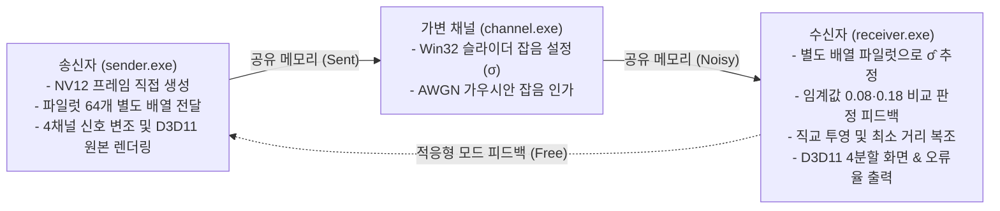

# 적응형 변조(BPSK·QPSK·16-QAM) 기반 실시간 NV12 비디오 전송 및 다중 뷰 비교 시뮬레이터

2026학년도 2학기 경희대학교 전자공학과 소프트웨어랩(EE370) 기말 Term Project  
- 학번: 2021104299  
- 이름: 이성욱  
- GitHub 저장소 URL: https://github.com/seongugi/Software_Lab  

---

## 1. 프로젝트 개요

본 프로젝트는 이동통신 등 전공 수업 시간에 이론으로 배운 적응형 변조(Adaptive Modulation) 기술이 실제 무선 채널 환경에서 어떻게 동작하는지 직관적으로 확인하고 분석하기 위해 제작한 비디오 통신 시뮬레이터입니다.

단순한 비트열이나 텍스트 전송, 정적 그래프 수치만으로는 잡음 크기에 따라 변조 방식이 전환되는 과정과 각 방식의 장단점을 체감하기 어려웠습니다. 이에 소프트웨어랩 6강(QPSK channel)에서 배운 디지털 변복조 이론과 2강(YUV format)에서 다룬 비디오 프레임 구조를 결합하여, 잡음 환경에 따른 '실제 영상의 화질 변화'를 2×2 화면으로 직접 관찰할 수 있도록 구성했습니다.

6강에서 다룬 디지털 변조 방식 중 16-QAM과 같은 고차 변조는 심볼당 4비트를 전송하여 효율이 높지만 잡음이 커지면 오류가 늘어나 영상이 쉽게 깨지고, 반대로 BPSK와 같은 저차 변조는 잡음에 견고하지만 심볼당 1비트만 전송한다는 특징이 있습니다. 본 시뮬레이터는 이러한 트레이드오프를 한눈에 비교할 수 있도록, 2강의 YUV 4:2:0 구조를 적용한 64×40 NV12 프레임을 실시간 생성하여 [적응형 vs 고정 16-QAM vs 고정 QPSK vs 고정 BPSK] 4개 경로로 동시 처리하고, 수신 화면에서 실시간 화질과 바이트 오류율(%)을 직접 비교 검증합니다.

---

## 2. 연계 강의 및 핵심 원리

### 2.1 연계 강의
- 6강 QPSK channel (직접 연계, 핵심):
  - 강의에서는 비트를 QPSK 심볼로 변환하고 AWGN 채널을 거쳐 비트 오류율(BER)을 계산하는 단일 시뮬레이션을 다루었습니다.
  - 본 프로젝트는 이 핵심 원리를 직접 확장하여, QPSK뿐만 아니라 BPSK(심볼당 1비트), 16-QAM(심볼당 4비트)까지 직교 기저 반송파(c0, c1)와 I-Q 성상도 매핑 기법으로 구현했습니다.
  - 수신단에서는 직교 투영 및 최소 유클리드 거리 판정 디코더로 신호를 복조하고, 비디오 평가를 위한 바이트 오류율(%)을 실시간 산출합니다.
  - 강의의 4모듈(Sender-Channel-Receiver-Evaluator) 구조를 바탕으로 송신자, 가변 채널, 수신자의 3개 독립 프로세스로 파이프라인을 구성했습니다.
- 2강 BMP 및 YUV 포맷 (간접 연계):
  - 2강에서 다룬 영상의 YUV(YCbCr 4:2:0) 색공간 및 메모리 배열(Luma Y 평면과 서브샘플링된 Chroma UV 평면)을 참고했습니다.
  - 텍스트나 난수 비트열 대신, 프로그램 내부에서 좌표 조건으로 오른쪽 위에 고정된 태양과 좌우로 움직이는 집 객체를 포함한 64×40 해상도 NV12(YUV420 semi-planar) 비디오 프레임을 직접 생성하여 전송 데이터로 사용함으로써, 복조 오류에 따른 영상 왜곡을 직관적으로 확인할 수 있도록 했습니다.

### 2.2 강의 실습 대비 확장 및 구현 내용
1. 파일럿 64개 기반 실시간 채널 잡음 추정 (σ̂):
   - 송신기는 프레임마다 파일럿 심볼 64개를 공유 메모리의 별도 배열로 전달하고, 수신기는 파일럿의 직교 투영 오차를 측정하여 현재 채널의 잡음 표준편차 σ̂를 실시간 추정합니다.

   σ̂ = √[ 1 / (2 × 64) · Σ_{k=0}^{63} ( (I_k - 1)² + Q_k² ) ]

2. 폐루프 적응형 변조 전환 정책:
   - 수신단은 추정 잡음 σ̂와 임계값 0.08·0.18을 비교해 다음 프레임의 변조 방식을 선택하여 송신단에 피드백합니다.
     - σ̂ < 0.08: 16-QAM 선택 (심볼당 4비트)
     - 0.08 ≤ σ̂ < 0.18: QPSK 선택 (심볼당 2비트)
     - σ̂ ≥ 0.18: BPSK 선택 (심볼당 1비트)
   - 임계값(0.08, 0.18) 설계 근거: 디지털 통신 Q-함수 이론 모델(§6.2 참조)을 통해 각 변조 방식의 바이트 오류율이 급격히 증가하는 변곡점(16-QAM: 0.08 부근, QPSK: 0.18 부근)을 수학적으로 분석하여, 영상 왜곡을 사전에 방지하도록 과학적 근거를 바탕으로 도출했습니다.
3. 4채널 비디오 멀티뷰 동시 비교:
   - 동일한 가변 AWGN 채널 환경에서 같은 비디오 프레임을 4개 경로(적응형, 고정 16-QAM, 고정 QPSK, 고정 BPSK)로 동시에 처리하여, 변조 방식별 화질 열화와 바이트 오류율(%)의 차이를 한 화면에서 직관적으로 대조합니다.
4. 구현 보조 도구 (Direct3D 11 및 Shared Memory):
   - 2×2 비디오 화면을 부드럽게 출력하기 위한 보조 도구로 `ID3D11VideoProcessor`를 활용해 NV12 서페이스를 렌더링하고, 프로세스 간 프레임 전달 및 순서 제어를 위해 Windows Named Shared Memory와 원자적 연산을 활용했습니다.

---

## 3. 시스템 아키텍처 및 동작 원리

### 3.1 프로세스 구성
시스템은 3개의 독립 실행 파일(.exe)로 구성되며, Windows 공유 메모리(`AdaptiveVideoNv12Tuned`)를 통해 데이터를 교환합니다.



### 3.2 프레임 처리 및 동기화 메커니즘
- 50ms 타이머 기반 시도: 각 프로세스는 50ms 주기 타이머(`SetTimer`)로 프레임 처리를 시도하며, 이전 프레임 처리가 끝나면 다음 프레임을 전송합니다.
- 순차 상태 전이: 공유 메모리의 `state` 필드를 원자적(Atomic)으로 검사하여, 이전 프레임의 수신 처리가 완전히 끝나 `Free` 상태가 되었을 때만 송신자가 다음 프레임을 전송합니다.
  - `Free`: 채널이 비어 있음 (수신자 처리 완료)
  - `Sent`: 송신자가 신호를 송신 완료함
  - `Noisy`: 채널 프로세스가 가우시안 잡음을 추가함 (수신 대기)

### 3.3 프레임 데이터 규격
- 비디오 규격: 64×40 해상도, NV12 (YUV 4:2:0 Semi-Planar) 포맷
  - Luma (Y 평면): 64 × 40 = 2,560 바이트
  - Chroma (UV 인터리빙 평면): 2,560 / 2 = 1,280 바이트
  - 프레임당 총 데이터량: 3,840 바이트 (30,720 비트)
- 변조 기저 함수: 반송파 주기당 샘플 수 N = 20, 사인·코사인 기저파형 사용
  
   
   c0[k] = √(2/N) · cos(2πk / N),  c1[k] = √(2/N) · sin(2πk / N)  (k = 0, 1, ..., 19)
   


---

## 4. 개발 환경 및 요구 사항

- 운영체제: Microsoft Windows 10 / 11 (64-bit)
- 컴파일러: MinGW-w64 `g++` (C++17 표준 지원, 버전 11 이상 권장)
- 실행 환경: Windows PowerShell
- 그래픽스 API: DirectX 11 (Direct3D 11, DXGI)
- 시스템 라이브러리: `-ld3d11`, `-ldxgi`, `-lgdi32`, `-luser32`

---

## 5. 빌드 및 실행 방법

### 5.1 빌드 (컴파일)

제출 폴더 루트에서 PowerShell을 열고 아래 명령을 실행합니다.

```powershell
cd .\src

# 1. 가변 잡음 채널 프로세스 빌드
g++ -std=c++17 -O2 channel.cpp -o channel.exe -lgdi32 -luser32

# 2. 송신자 프로세스 빌드
g++ -std=c++17 -O2 sender.cpp -o sender.exe -ld3d11 -ldxgi -lgdi32 -luser32

# 3. 수신자 프로세스 빌드
g++ -std=c++17 -O2 receiver.cpp -o receiver.exe -ld3d11 -ldxgi -lgdi32 -luser32
```

### 5.2 실행 순서

프로세스들은 공유 메모리를 통해 통신하므로 임의 순서로 실행 가능하지만, 원활한 관찰을 위해 다음 순서를 권장합니다.

1. `channel.exe` 실행:
   - 가변 AWGN 채널 창이 열리며, 상단에 슬라이더가 표시됩니다.
   - 슬라이더를 조절하여 채널 가우시안 잡음 표준편차 σ를 실시간으로 변경할 수 있습니다.
2. `sender.exe` 실행:
   - Direct3D 11 비디오 렌더러가 구동되며, 좌표 조건으로 직접 생성되는 원본 NV12 비디오 화면이 표시됩니다.
3. `receiver.exe` 실행:
   - 2×2 그리드로 구성된 멀티뷰 창이 열립니다.
   - 좌측 상단: 적응형(Adaptive) 모드 화면
   - 우측 상단: 고정 16-QAM 화면
   - 좌측 하단: 고정 QPSK 화면
   - 우측 하단: 고정 BPSK 화면
   - 각 패널 상단에 [모드명 | 현재 변조 방식 | 실시간 바이트 오류율(%)] 및 [심볼당 전송 비트 수] 텍스트 오버레이가 실시간 표시됩니다.

---

## 6. 실험 결과 및 정량 분석

### 6.1 잡음 환경별 실제 측정 결과

채널 슬라이더의 설정 잡음 σ를 조절하면서 수신자 GUI에 표시되는 실시간 지표를 관찰하고 측정한 결과는 다음과 같습니다. (수신기는 파일럿으로 추정한 잡음 σ̂에 따라 다음 프레임의 변조 방식을 동적으로 선택합니다.)

> 참고: 아래 표의 수치는 각 잡음 조건에서 캡처한 한 프레임의 바이트 오류율 표시값입니다.

| 설정 잡음 수준 (σ) | 해당 모드의 선택 조건 | 적응형 경로 변조 방식 | 심볼당 비트 수 | 적응형 오류율 | 고정 경로 오류율 비교 | 화질 및 관찰 결과 |
| :---: | :---: | :---: | :---: | :---: | :---: | :--- |
| 저잡음 (σ = 0.015) | σ̂ < 0.08 | 16-QAM | 심볼당 4비트 | 0.00% | 16-QAM: 0.00%<br/>QPSK: 0.00%<br/>BPSK: 0.00% | 4개 경로 모두 왜곡 없이 원본 영상을 완벽히 복원하며, 적응형 경로는 심볼당 4비트(BPSK 대비 같은 심볼 수에 실을 수 있는 비트 수가 4배)를 전송하여 효율을 확보함. ([캡처 1](results/01_low_noise_16qam.png)) |
| 중잡음 (σ = 0.120) | 0.08 ≤ σ̂ < 0.18 | QPSK | 심볼당 2비트 | 0.00% | 16-QAM: 2.73%<br/>QPSK: 0.00%<br/>BPSK: 0.00% | 고정 16-QAM은 오류율 2.73%로 하늘과 배경에 노이즈 점이 발생하기 시작하나, 적응형은 QPSK로 자동 전환되어 0.00% 오류율로 깨끗한 영상을 유지함. ([캡처 2](results/02_mid_noise_qpsk.png)) |
| 고잡음 (σ = 0.250) | σ̂ ≥ 0.18 | BPSK | 심볼당 1비트 | 0.03% | 16-QAM: 50.99%<br/>QPSK: 1.93%<br/>BPSK: 0.03% | 고정 16-QAM은 오류율 50.99%로 화면 전체에 극심한 컬러 노이즈가 발생하고 고정 QPSK도 1.93%의 오류율을 보이지만, 적응형은 BPSK로 전환되어 σ=0.250의 해당 캡처에서 바이트 오류율이 0.03%로 안정적으로 영상을 복원함. ([캡처 3](results/03_high_noise_bpsk.png)) |

### 6.2 분석 및 고찰

1. 변조 방식별 트레이드오프 실측 검증:
   - 16-QAM은 심볼당 4비트, BPSK는 심볼당 1비트를 전송합니다. 같은 심볼 수에 실을 수 있는 비트 수에서 4배의 전송 효율 차이가 납니다.
   - 저잡음(σ = 0.015)에서는 16-QAM도 0.00%의 바이트 오류율을 기록하므로 적응형 경로는 심볼당 4비트를 채택하는 것이 가장 유리합니다.
   - 잡음이 σ = 0.250으로 커지면 고정 16-QAM은 성상도 오판정으로 바이트 오류율이 50.99%까지 치솟아 화면이 완전히 붕괴하지만, 적응형 경로는 심볼당 1비트의 견고한 BPSK로 자동 전환되어 바이트 오류율을 0.03%로 억제하고 안정적으로 영상을 복원합니다.

2. 시뮬레이션 데이터(simulation_data.csv) 항목 정의:
   - `sigma`: 가우시안 잡음 표준편차 σ (0.010부터 0.350까지 200구간 균등 분할)
   - `adaptive_bits_per_symbol`: 적응형 경로가 선택한 심볼당 전송 비트 수 (4.0 / 2.0 / 1.0)
   - `adaptive_byte_error_rate_pct`: 적응형 경로의 이론적 바이트 오류율 (%)
   - `16qam_byte_error_rate_pct`: 고정 16-QAM 경로의 이론적 바이트 오류율 (%)
   - `qpsk_byte_error_rate_pct`: 고정 QPSK 경로의 이론적 바이트 오류율 (%)
   - `bpsk_byte_error_rate_pct`: 고정 BPSK 경로의 이론적 바이트 오류율 (%)

3. 이론 계산 모델의 구체적 유도 수식:
   소프트웨어랩 6강에서 배운 AWGN 채널의 비트 오류 확률(BER, Bit Error Rate) Q-함수 이론식을 기반으로 출발합니다.

   [단계 1: 변조 방식별 비트 오류 확률 (BER)]
   - BPSK 비트 오류 확률:
     Pb_BPSK = Q( 1 / σ )
   - QPSK 비트 오류 확률 (직교 I/Q 독립 복조):
     Pb_QPSK = Q( 1 / σ )
   - 16-QAM 비트 오류 확률 (I/Q 축별 4-PAM 분해 및 평균 에너지 정규화 계수 √5 반영):
     Pb_16QAM ≈ (3/4) · Q( 1 / (√5 · σ) )

   [단계 2: 비트 오류율에서 1바이트 오류율로의 유도]
   - NV12 비디오는 픽셀 데이터가 1바이트(8비트) 단위로 구성되며, 8비트 중 단 1비트라도 오차가 발생하면 해당 픽셀 바이트 전체가 오염(깨짐)됩니다.
   - 8비트가 모두 오류 없이 전송될 확률: (1 - Pb)^8
   - 따라서 1바이트 오류율(Byte Error Rate, %) 계산식:
     Byte_Error_Rate(%) = [ 1 - (1 - Pb)^8 ] × 100

4. 이론 곡선 그래프(byte_error_rate_curve.png)와 임계값(0.08, 0.18) 설계 근거:
   위 수식으로 계산된 200개 데이터 포인트가 바로 [results/byte_error_rate_curve.png] 그래프의 곡선입니다.
   이 그래프를 통해 단순 감이 아닌 수학적 통신 이론에 기반하여 모드 전환 임계값을 도출했습니다.

   - 제1 임계값 (σ = 0.08) 도출 근거:
     - σ < 0.08 구간: 16-QAM의 바이트 오류율이 0.02% 이하로 사실상 0%를 유지하므로, 전송 속도가 4배 빠른 16-QAM(심볼당 4비트)을 유지하여 효율을 극대화합니다.
     - σ = 0.08 변곡점: 16-QAM의 바이트 오류율이 지수 함수적으로 급증하기 시작하는 임계 지점입니다. 영상 왜곡을 사전에 방지하기 위해 첫 번째 임계값을 σ̂ = 0.08로 설정하고, 여전히 오류율이 0.00%를 유지하는 QPSK(심볼당 2비트)로 즉시 전환합니다.
   - 제2 임계값 (σ = 0.18) 도출 근거:
     - σ = 0.18 변곡점: QPSK의 바이트 오류율도 0.05%를 넘어서며 노이즈가 보이기 시작하는 지점입니다. 두 번째 임계값을 σ̂ = 0.18로 설정하고, 잡음에 가장 강인한 BPSK(심볼당 1비트)로 최종 전환하여 심각한 잡음(σ = 0.250 이상)에서도 비디오 동기와 객체 형태를 끝까지 보존합니다.

5. 통계적 편차 및 연속 구동:
   - 위 이론 곡선은 이상적 상태(σ̂ ≈ σ)를 가정한 기준선이며, 실제 프로그램은 프레임당 64개 파일럿 샘플로 잡음을 추정하므로 경계 부근에서 약간의 통계적 편차가 발생할 수 있습니다.
   - 송신자·채널·수신자 3개 프로세스를 60초 이상 연속 구동할 때 멈춤 없이 수신 화면과 오버레이가 실시간 갱신됨을 확인했습니다.
6. 산출물 목록:
   - 실행 화면 캡처: [저잡음 16-QAM](results/01_low_noise_16qam.png), [중잡음 QPSK](results/02_mid_noise_qpsk.png), [고잡음 BPSK](results/03_high_noise_bpsk.png)
   - 이론 계산 곡선: [바이트 오류율 및 심볼당 비트 수 곡선](results/byte_error_rate_curve.png)
   - 계산 수치 데이터: [simulation_data.csv](results/simulation_data.csv)

---

## 7. AI 도구 활용 내역

본 프로젝트는 AI 도구(ChatGPT)를 활용하여 개발 효율성을 높였으며, 활용 내역은 다음과 같습니다.

| 활용 항목 | 사용 도구 | 프롬프트 및 활용 내용 | 검증 및 보완 방법 |
| :--- | :---: | :--- | :--- |
| DirectX 11 영상 화면 출력 기본 틀 | ChatGPT | "DirectX 11에서 NV12 비디오 화면을 창에 띄우는 기본 C++ 코드 구조 알려줘" | 공식 문서와 예제를 참고해 프로젝트 비디오 규격(64×40)에 맞게 옵션을 수정하고, 화면이 정상 출력되는지 실행하며 확인 |
| 3개 프로그램 간 데이터 공유(통신) | ChatGPT | "C++에서 송신자, 채널, 수신자 3개 프로그램이 데이터를 주고받을 수 있는 공유 메모리 기본 코드 알려줘" | 프로그램들이 동시에 읽고 쓸 때 데이터가 엉키지 않도록 순서 제어 코드를 직접 보완하고, 멈춤 없이 연속 구동되는지 테스트 |
| 변조 방식(BPSK·QPSK·16-QAM) 수식 점검 | ChatGPT | "BPSK, QPSK, 16-QAM 신호의 세기를 동일하게 맞춰주는 정규화 공식과 직교 반송파 수식 알려줘" | 소프트웨어랩 6강 강의자료의 이론 수식과 하나씩 직접 대조하여 올바른 계산식이 적용되었는지 검증 |

---

## 8. 참고자료 및 출처

1. 경희대학교 전자공학과 소프트웨어랩(EE370) 강의자료:
   - 6강: *QPSK channel* (직교 기저 반송파 생성, I-Q 성상도 매핑 및 복조 이론)
   - 2강: *BMP file & YUV format* (YCbCr 4:2:0 색공간 및 비디오 서브샘플링 메모리 구조)
2. 위키피디아 (Wikipedia):
   - [Link adaptation (Adaptive modulation and coding)](https://en.wikipedia.org/wiki/Link_adaptation) — 채널 상태에 따른 변조 방식 동적 선택 개념
   - [Constellation diagram](https://en.wikipedia.org/wiki/Constellation_diagram) — BPSK, QPSK, 16-QAM 성상도 다이어그램 및 신호점 배치
   - [Quadrature amplitude modulation (QAM)](https://en.wikipedia.org/wiki/Quadrature_amplitude_modulation) — 직교 변조 원리
